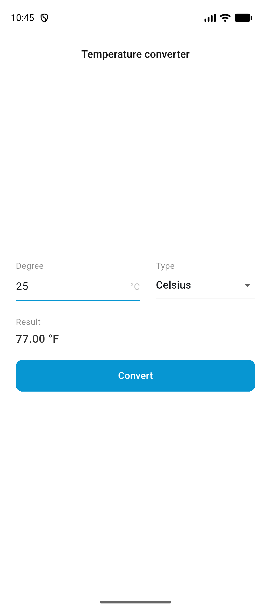
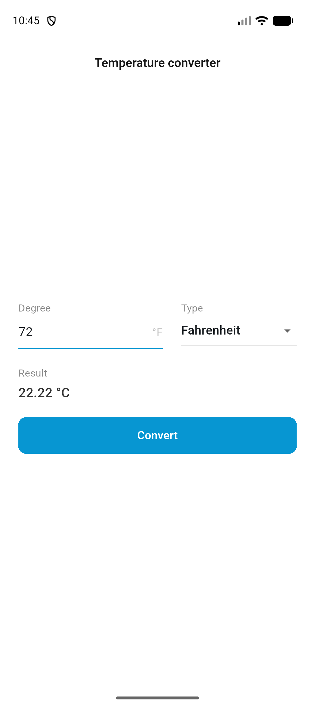

# Temperature Converter

A simple Flutter app for converting temperatures between Celsius and Fahrenheit.

## Screenshots

### Celsius to Fahrenheit

25 °C → 77.00 °F



### Fahrenheit to Celsius

72 °F → 22.22 °C



## Getting Started

Run the app with Flutter:

```sh
flutter pub get
flutter run
```
