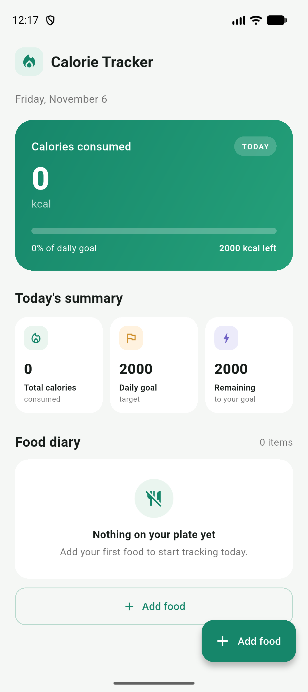
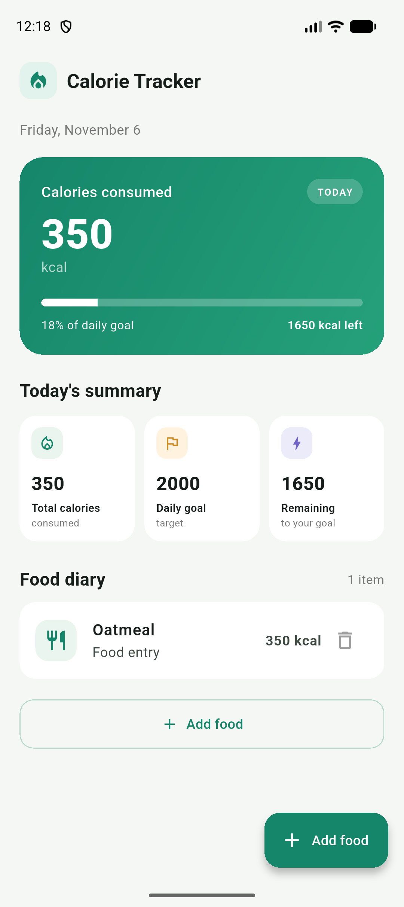

# Calorie Tracker

A simple Flutter app for recording food and tracking daily calorie intake against a 2,000 kcal goal.

## Screenshots

| Daily summary | Food added |
| --- | --- |
|  |  |

## Features

- Shows today's date, calories consumed, the daily goal, and calories remaining.
- Add a food name and calorie amount with input validation.
- View food entries and remove them from the diary.
- Keeps entries in memory; the list resets when the app restarts.

## Run the app

```bash
flutter pub get
flutter run
```
