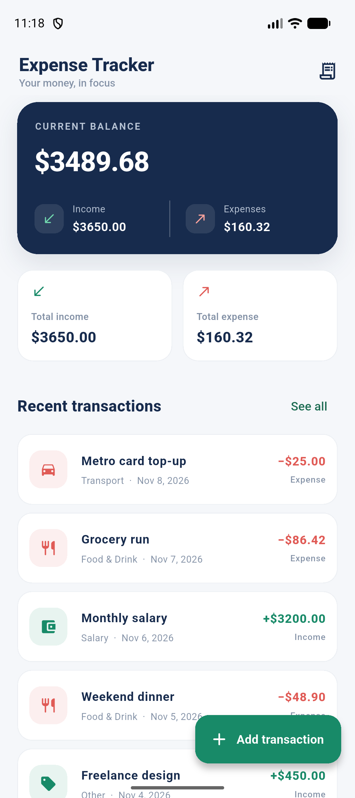
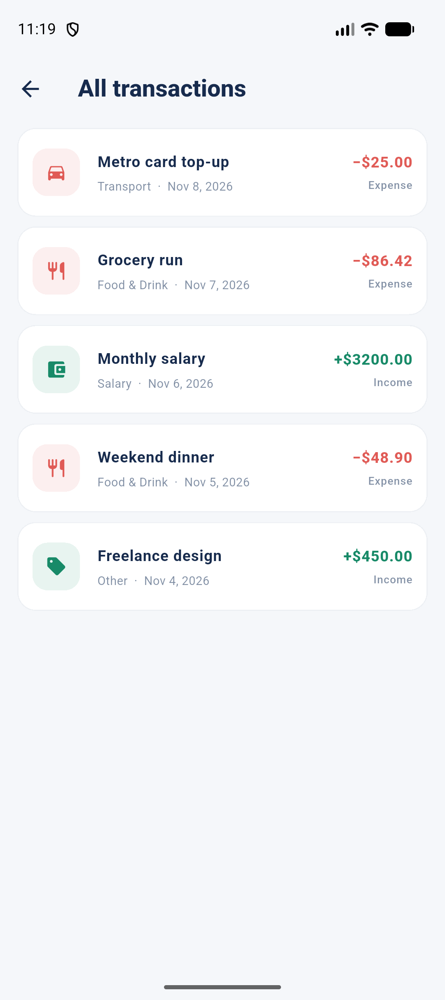
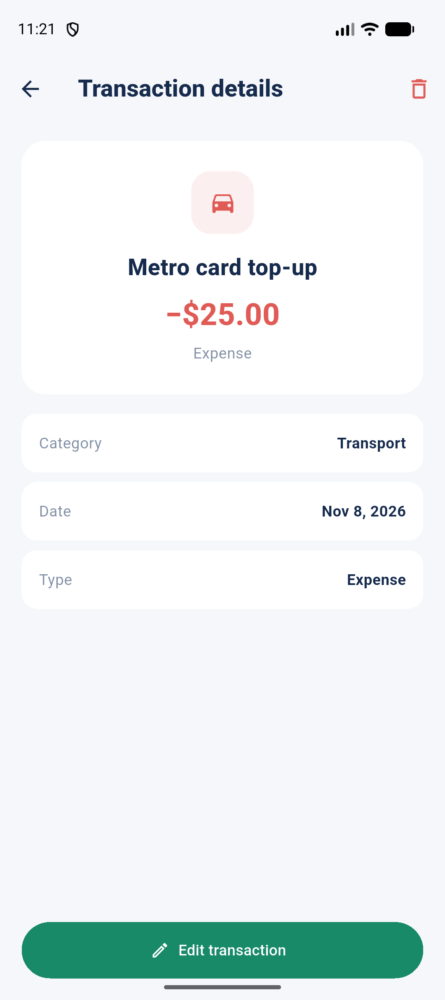
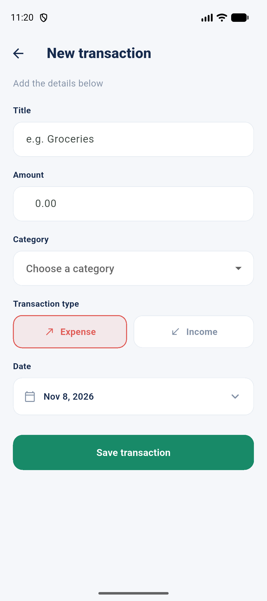
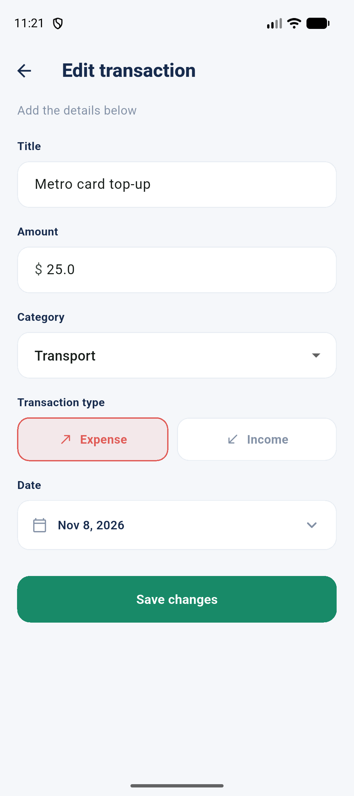

# Expense Tracker

A Flutter app for tracking income and expenses with local SQLite storage. Add, edit, view, and delete transactions, and see your totals update on the dashboard.

## Screenshots

Screenshots were captured from the Android emulator.

| Dashboard | All transactions | Transaction details |
| --- | --- | --- |
|  |  |  |

| Add transaction | Edit transaction |
| --- | --- |
|  |  |

## Run the app

```sh
flutter pub get
flutter run
```

Transactions are stored on device in `expense_tracker.db`. A small set of demo transactions is inserted on first launch when the database is empty.
